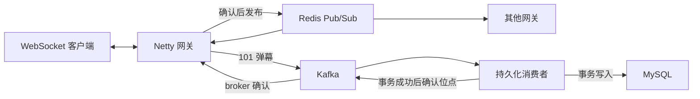

# DanmakuFlow-Java

Java 直播弹幕后端，支持 WebSocket 协议、Redis 跨节点广播、房间统计和 Kafka → MySQL 异步持久化。

**维护状态：暂停。**自 2026-11-06 起，以 [DanmakuFlow](https://github.com/JavaLyHn/DanmakuFlow) 的 Go 版本为开发主线。当前 Java 源码和提交历史保留，只有收到明确的同步指令后才继续 Java 开发或同步选定改动。

支持房间内弹幕、点赞、在线连接数统计和跨网关广播，以及独立的批量持久化进程。这里不包含视频推流、前端播放器或账号认证；`uid` 是客户端提供的开发协议身份，不能视为已认证用户。

Java 迁移按模块分步提交。已有有限功能测试，真实 Redis/Kafka/MySQL 全链路和 Java 性能对比仍待验证；配置中的连接上限不是已测容量。

## 架构



网关使用 Spring Boot 非 Web 上下文管理生命周期，Netty 处理网络。Lettuce 负责 Redis 异步命令与 Pub/Sub；Kafka 发送放在独立的有界队列中。MySQL 只由持久化进程访问。

| 模块 | 职责 |
| --- | --- |
| `danmaku-protocol` | 101/102/103 协议、uint64 与输入边界、存储事件格式 |
| `danmaku-gateway` | WebSocket、房间生命周期、背压、Redis/Kafka 适配 |
| `danmaku-persistence` | Kafka 消费、Flyway、JDBC 事务与 event_id 去重 |
| `danmaku-tools` | 单连接 Java 命令行客户端，无自动压测 |
| `legacy/go` | 固定版本的原始代码快照与原作者许可 |

## 构建与运行

需要 Java 21 和 Maven 3.9+：

```sh
mvn -B -T1 package
```

构建使用串行、有限堆的测试配置，无需启动数据服务。Netty 功能测试会短暂绑定本机随机回环端口。详细限制见 [构建说明](docs/migration/BUILD.md)。

实际运行网关需要独立 Redis 和 Kafka；持久化进程还需要预先创建的专用 MySQL 8.4 数据库。应用不会自动部署这些服务，也不会接管原 Go 数据库。

- [网关配置与启动](danmaku-gateway/README.md)
- [持久化配置与启动](danmaku-persistence/README.md)
- [交互客户端](danmaku-tools/README.md)
- [协议和可靠性语义](docs/migration/PROTOCOL.md)

默认 WebSocket 地址是 `ws://127.0.0.1:8080/ws?uid=1&name=demo&room=test`。弹幕先获得 Kafka broker 确认，再发布到 Redis；数据库事务成功后才提交消费位点。Kafka 与 Redis 之间没有原子事务，Pub/Sub 断线不补发，客户端重发也不保证全局 exactly-once。

## 迁移记录

- [迁移范围与架构](docs/superpowers/specs/2026-11-06-java-migration.md)
- [分步实现计划](docs/superpowers/plans/2026-11-06-java-migration.md)
- [进展记录与已暂停的 Go 基线](docs/migration/PROGRESS.md)
- [已执行与待完成的验证](docs/migration/VALIDATION.md)
- [后续性能对比与 JMeter 计划（未执行）](docs/migration/PERFORMANCE.md)

Java 实现的许可见 [LICENSE](LICENSE)，随附 Go 参考代码的许可见 [legacy/go/LICENSE](legacy/go/LICENSE)。
